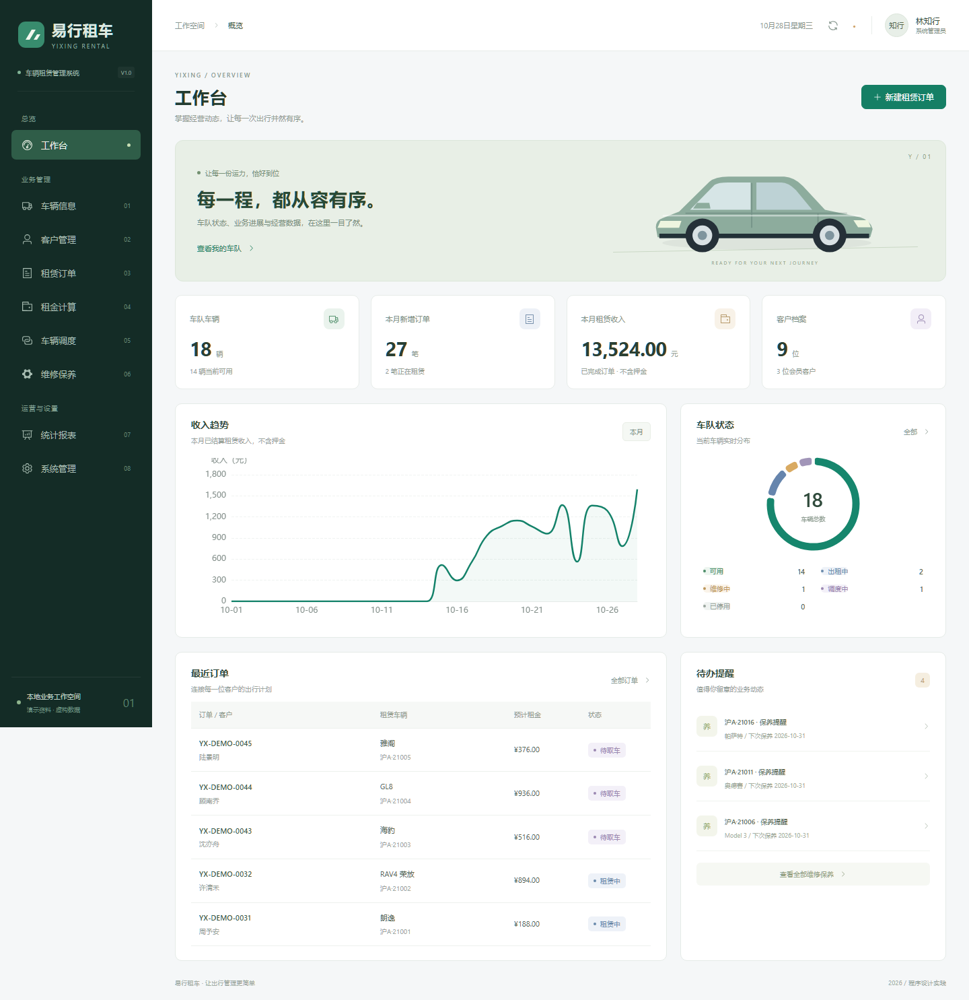

# 易行租车 · 车辆租赁管理系统

一个可以本地运行的程序设计实践项目。前后端真实联通，包含八个明确区分的业务模块、账号权限、虚构演示数据及自动化测试，不是仅展示页面的静态原型。

## 一、立即使用

首次克隆后，请先安装 Java 21、Maven 3.9+、Node.js 22 和 Python 3，并确保相应命令可在终端运行。运行 `python scripts/run.py` 会自动安装前端依赖，并在缺少构建产物时编译前后端。

当前电脑已准备好工作区内的 Java 21、Maven 和前端依赖。服务运行时访问：

**http://127.0.0.1:5173/**

- 管理员：`admin` / `Admin@12345`
- 业务人员：`staff` / `Staff@12345`，在“管理员登录”入口进入，与管理员共用完整管理权限。
- 客户：选择“客户登录”后可自主注册，或由管理员在客户建档后关联登录账号；客户只可访问本人资料与订单。

以上为本地课程演示账号，不要将默认账号直接用于公网环境。客户资料全部为虚构。

服务未运行时，在项目根目录执行：

```powershell
python scripts/run.py
```

也可双击根目录的 `start.cmd`。运行窗口保持开启，按 `Ctrl+C` 停止由该脚本启动的前后端。脚本只绑定本机回环地址，不会主动开放局域网或公网访问。

重新编译并执行后端测试：

```powershell
python scripts/run.py --build
```

运行日志位于 `data/runtime/`。如果 8080 或 5173 已占用，脚本会提示，不会自动关闭其他程序。

构建产物不纳入 Git，首次启动会自动构建；开发时使用 `python scripts/run.py --dev` 启用前端热更新。修改后端后需停止服务并使用 `--build` 重新构建。

## 二、已实现模块

### 01 · 车辆信息管理

车辆卡片和列表双视图，支持新增、编辑、筛选、分页、CSV 导出、图片上传、详情、历史订单与维修记录。支持停用和启用，状态随交车、还车、调度及维修操作变化。

### 02 · 客户管理

支持登记、编辑、筛选和分页，管理驾驶证有效期、会员类别及限制租赁状态。展示历史订单与逾期、损坏摘要，列表和详情脱敏展示证件与电话。

### 03 · 租赁订单管理

支持创建、修改预约、取消退款、收取押金和预收租金、交车、还车、补款退款、结算和 CSV 导出。保存价格快照，检查时间重叠，使用事务和车辆行锁防止并发重复预约。

### 04 · 租金计算

支持按天、按里程、包月计费与独立试算，展示所选车辆单价与计算依据。按天只选日期范围，按里程只输入公里数，包月只选本年度起租月份，以现有 30 天计费月规则试算。删除独立价格规则表；已有订单价格快照不变。

### 05 · 车辆调度

展示各门店车辆分布，支持创建、开始、完成、取消调度任务。校验关联预约和车辆状态，完成后更新车辆所属门店。

### 06 · 维修保养

支持维修保养工单创建、开始、完成、取消和历史查询。可设置下次保养日期及里程，按提醒参数生成提示；待处理工单仍保留提醒，点击开始后消失，无提醒时整块隐藏。损坏还车会自动生成检修工单。

### 07 · 报表统计

支持日期区间查询、收入与订单趋势、带车型图片的统一车辆排行，可在时长、次数、已结算租金收入之间切换；每日明细按日期倒序，支持维修费用汇总及 CSV 导出。收入按已完成订单的结算日期统计，押金不计入收入。

### 08 · 系统管理

支持管理员与客户两类角色；业务人员以 STAFF 账号类型保留身份，权限合并为管理员。支持团队及客户账号、门店、提醒参数、密码修改和操作日志，移除公司名称编辑。支持管理员导出 ZIP 备份并恢复可信备份，包含数据与上传图片；恢复后全部登录会话失效。

### 客户端

独立的选车出行、我的订单、个人资料三个页面。客户可试算、预约、取消未收款的待取车订单、查看收退款并更新本人联系方式和驾照资料。后台按会话身份限定客户归属，不信任前端传入的客户编号；收款、交还车和结算由管理端处理。

## 三、技术与目录

前端采用 Vue 3、Element Plus、Axios、ECharts、Vite；后端采用 Spring Boot、MyBatis，认证采用服务端会话，密码采用 BCrypt 哈希。

- `frontend/src/views/`：工作台、登录及八个独立业务页面。
- `frontend/src/components/`：状态标签、图表、通用表单弹窗、车辆插画。
- `backend/src/main/java/com/yixing/`：按认证、车辆、客户、订单、计费、调度、维修、报表、系统等业务包区分。
- `backend/src/test/java/com/yixing/`：计费单元测试与业务集成测试。
- `database/`：H2 和 MySQL 数据库结构脚本。
- `scripts/`：项目启动脚本。
- `tests/`：独立浏览器验收脚本、测试依赖、验收结果。
- `docs/`：接口、协作、UI 规范、验收报告、运行截图和录屏。
- `.github/`：PR 提交检查模板。

GitHub 仓库：https://github.com/AprilHRH/yixing-rental（私有，需要仓库访问权限）。团队可克隆同一个仓库，按 `docs/团队协作.md` 创建任务分支、提交和发起 PR。

仓库保留源码、依赖锁文件、数据库结构、车型素材及项目文档；本地数据库、上传文件、依赖目录、构建产物、工具包、临时文件和测试录屏不上传。首次运行会独立初始化演示数据。

## 四、数据库说明

### 默认模式：本地 H2 持久化

为使当前没有 MySQL 服务的电脑也能直接运行，默认使用兼容 MySQL 模式的 H2 文件数据库。真实业务数据保存在根目录 `data/yixing.mv.db`，不是浏览器缓存，重启后仍然保留。

首次运行会初始化 18 辆车辆、9 位虚构客户、3 家门店、4 套价格规则、历史订单及调度维修记录。已存在账号时不会重复初始化数据。演示日期以第一次初始化当天为基准。

### 可选模式：MySQL

准备 MySQL 并创建空数据库 `yixing`，配置以下环境变量后启动：

```powershell
$env:MYSQL_URL = 'jdbc:mysql://localhost:3306/yixing?useUnicode=true&characterEncoding=UTF-8&serverTimezone=Asia/Shanghai'
$env:MYSQL_USER = '你的数据库账号'
$env:MYSQL_PASSWORD = '你的数据库密码'
python scripts/run.py --mysql
```

后端会读取 `application-mysql.properties`，使用单独的 MySQL 建表脚本初始化。H2 与 MySQL 数据互不自动迁移。

**验证边界：当前完成了 H2 模式的集成及浏览器验收；MySQL 配置和结构脚本已提供，但未连接实际 MySQL 实例验证。**

## 五、业务规则

- 日租：每 24 小时计 1 天，不足 1 天向上取整，最低 1 天。
- 里程：起租费 + 实际行驶里程 × 公里单价。
- 包月：30 天为一个月，剩余天数按日租价。
- 实际费用 = 基础租金 + 附加费用 − 优惠。
- 净已收款 = 所有收款 − 已退款，包括已收押金。
- 实际费用高于净已收款时补收，低于时退差额。
- 所有收退款是线下登记，不会发起真实支付。
- 创建预约不立即将车辆变为出租中，实际交车后才改变。
- 相邻预约允许创建，但必须确认前一订单已归还才能交车。
- 驾驶证过期、不能覆盖租期或被限制租赁时不能下单。
- 交车须收齐押金，并在计划取车前 10 分钟至计划还车时间内办理。
- 为避免调度后门店与预约不一致，存在后续预约时先处理订单再调度。
- 开始维修前处理有效预约；紧急损坏还车可直接转入检修，后续预约必须人工调整。
- 订单已有收款时不直接改价，取消退款后重新创建。
- 实际交车和还车时间由后端记录，避免任意改写已发生的业务时间。

## 六、建议演示流程

1. 管理员登录，查看工作台和八个独立模块。
2. 新建一位虚构客户，并选一辆没有冲突预约的可用车辆。
3. 创建当前时间附近开始的订单，查看预计租金。
4. 打开订单详情，登记完整押金，再办理交车。
5. 办理还车，填写实际里程、车况和附加费用。
6. 确认线下补款或退款后结算，检查费用和收退款记录。
7. 查看统计报表的收入变化。
8. 为其他空闲车辆创建调度或保养工单，观察状态与门店变化。
9. 切换业务人员账号，验证系统管理和经营报表不可访问。

## 七、运行测试

后端测试使用独立内存数据库，不修改演示数据库：

```powershell
mvn -f backend/pom.xml test
```

当前电脑也可使用 `.tools/apache-maven-3.9.9/bin/mvn.cmd`，并将 `JAVA_HOME` 指向 `.tools/` 下的 JDK 目录。

前端构建：

```powershell
npm --prefix frontend run build
```

浏览器验收：

```powershell
pip install -r tests/requirements.txt
python -m playwright install chromium ffmpeg
python tests/browser_acceptance.py
```

验收脚本使用独立的 8081 后端、5174 前端及内存数据库，验证八个页面和租赁闭环，不修改主演示数据。需要这两个端口空闲，且后端 JAR 已构建。Windows 优先使用已安装的 Edge，也可使用 Playwright Chromium。

## 八、截图与文档



- [接口说明](docs/接口说明.md)
- [团队协作与完成标准](docs/团队协作.md)
- [UI 设计规范](docs/UI设计规范.md)
- [验收报告](docs/验收报告.md)
- [浏览器验收结果](tests/browser-results.json)

## 九、使用边界

本版本用于本地课程实践，不宣称具备生产级部署、安全审计或真实财务支付能力。列表分页和筛选在前端完成，数据规模适合课程演示；没有实现客户自助端、真实支付、外部征信、地图调度和细粒度可配置权限平台。

不要把 `data/`、`uploads/`、`.tools/`、`node_modules/` 或数据库密码提交到共享仓库。导出的备份包含客户和账号哈希等敏感资料，只恢复可信文件。
