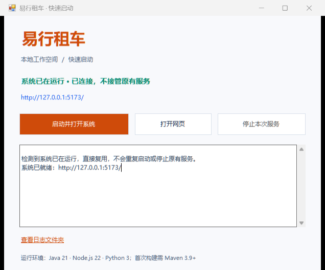

# 易行租车快速启动

## Windows 推荐入口

在完整项目根目录双击 **易行租车启动器.exe**，点击 **启动并打开系统**。也可以双击 `start.cmd` 打开同一个启动器。



启动器会检查当前服务；若已运行则直接打开网页，不重复启动，也不会关闭原有服务。否则自动安装缺少的前端依赖、构建缺少的前后端产物、启动两个服务，等待接口就绪后打开浏览器。

- **打开网页**：系统就绪后可再次打开首页。
- **停止本次服务**：仅停止本窗口启动的进程；复用外部服务时按钮禁用。
- **取消启动**：可以取消正在安装、构建或启动的任务。
- **查看日志文件夹**：打开 `data/runtime/`，包含前后端日志和首次构建日志。
- 关闭启动器时，如果仍在管理本次启动的服务，会先提示确认并停止这些服务；不会修改或删除数据库。

EXE 是项目启动入口，不是把所有依赖打包在一起的独立安装包。不要把它单独移出项目根目录。它没有安装系统服务、修改防火墙或设置开机自启。

## 首次运行环境

当前开发电脑已具备所需环境。其他电脑首次克隆后需安装：

- Windows 10 / 11 与 .NET Framework 4.8，用于原生桌面窗口。
- Python 3，并在安装时勾选加入 PATH；无需安装额外 Python 包即可启动。
- Java 21，设置 `JAVA_HOME` 或加入 PATH。
- Node.js 22，包含 npm。
- Maven 3.9+，用于首次构建后端。

启动脚本优先使用项目 `.tools/` 中已有的 JDK 与 Maven，再查找系统环境。GitHub 不包含本机工具、依赖、数据库和构建产物，因此其他电脑首次运行需要联网下载依赖，可能耗时几分钟；后续已有产物时直接启动。

浏览器地址为 `http://127.0.0.1:5173/`。管理员演示账号为 `admin` / `Admin@12345`，业务人员在管理员入口使用 `staff` / `Staff@12345`。客户可以自行注册。

## 命令行入口

跨平台启动，等待就绪后自动打开浏览器：

```powershell
python scripts/run.py --open
```

开发模式启用前端热更新：

```powershell
python scripts/run.py --dev --open
```

只检查服务，不启动、不安装、不停止：

```powershell
python scripts/run.py --check
```

停止现有项目服务后，重新测试并构建：

```powershell
python scripts/run.py --build --open
```

命令行模式用 Ctrl+C 停止本次启动的服务。命令行 `--mysql` 可切换至已经配置好的 MySQL；桌面启动器默认使用本地 H2。

## 常见情况

- 提示缺少 Python / Java / Node / Maven：安装对应版本后重新打开启动器，让新的 PATH 生效。
- 端口被其他程序占用：脚本会明确提示 8080 或 5173，不会误关其他程序；请先手动处理冲突。
- 另一个启动器正在启动或管理服务：等待原窗口启动完成，或者使用原窗口停止后再重试。
- 依赖下载或构建失败：查看窗口中的输出及 `data/runtime/build.log`，检查网络后重新启动。
- 修改代码后界面未更新：先停止服务，再执行重新构建命令；普通启动不会强制覆盖已有构建产物。
- Windows 首次提示未识别的发布者：该 EXE 是本项目源码编译的未签名程序；请先核对源码与仓库来源，不要关闭系统安全防护。

## 从源码生成启动器

项目保留 C# 源码 `scripts/Launcher.cs`，可使用 Windows 内置 .NET Framework 编译器重建，不需要安装 Visual Studio：

```powershell
powershell -NoProfile -ExecutionPolicy Bypass -File scripts/build-launcher.ps1
```

重新生成的 EXE 位于项目根目录。启动逻辑集中在 `scripts/run.py`，桌面程序只负责状态、日志和用户操作，不保存账号密码。

## 本次实际验证

- 启动脚本 14 项单元测试通过，覆盖服务识别、端口冲突、不重复启动、首次构建、缺少环境、取消和进程清理。
- 原生 EXE 实际打开窗口并点击启动：成功连接已有服务，打开网页按钮启用，停止外部服务按钮禁用，关闭窗口后原有服务仍正常运行。
- 在独立随机端口和内存 H2 数据库启动真实 Java 后端与 Vite 前端，验证 API 代理正常，再停止两个本次启动的进程；未占用或修改当前演示环境。
- Windows PowerShell 5.1 编译脚本实际通过，保留 C# 源码，EXE 可重复生成。

复核命令为 `python tests/test_launcher.py`、`python tests/launcher_window_preview.py` 和 `python tests/launcher_cold_start.py`。后两项为当前 Windows 开发电脑的浏览器/窗口及真实服务复核，先运行现有项目，并确保已生成前后端产物；窗口复核需先安装测试依赖。
