# 当前版本界面截图

更新日期：2026-10-29。以下为当前生产构建的实际运行截图，已采用暖橙透明摄影菜单、明亮字体与数字、亮色车辆状态环图。不是设计稿，也没有为了截图增加或改写业务记录。

桌面截图为 1451 × 900，窄屏截图为 390 × 844；长页面按完整内容截图。Windows 启动器单独按实际窗口截取。

所有网页截图均等待图片、页面及图表加载完成后拍摄，并检查脚本错误、资源请求、页面溢出以及拍摄前后业务数据摘要；记录见 `previews/current/manifest.json`。

## 1. 管理员登录

全幅品牌摄影，管理员与业务人员使用同一入口。

## 2. 客户登录

独立客户登录入口，不展示管理端操作。

## 3. 客户注册

截图仅展示表单，未提交注册或新增演示记录。

## 4. 工作台首屏

暖橙透明摄影侧栏、明亮数字、业务待办与亮色车队环图。

## 5. 工作台完整页面

下方收入趋势与最近订单使用真实现有业务数据。

## 6. 车辆信息

统一透明车型参考图，业务车牌单独展示。

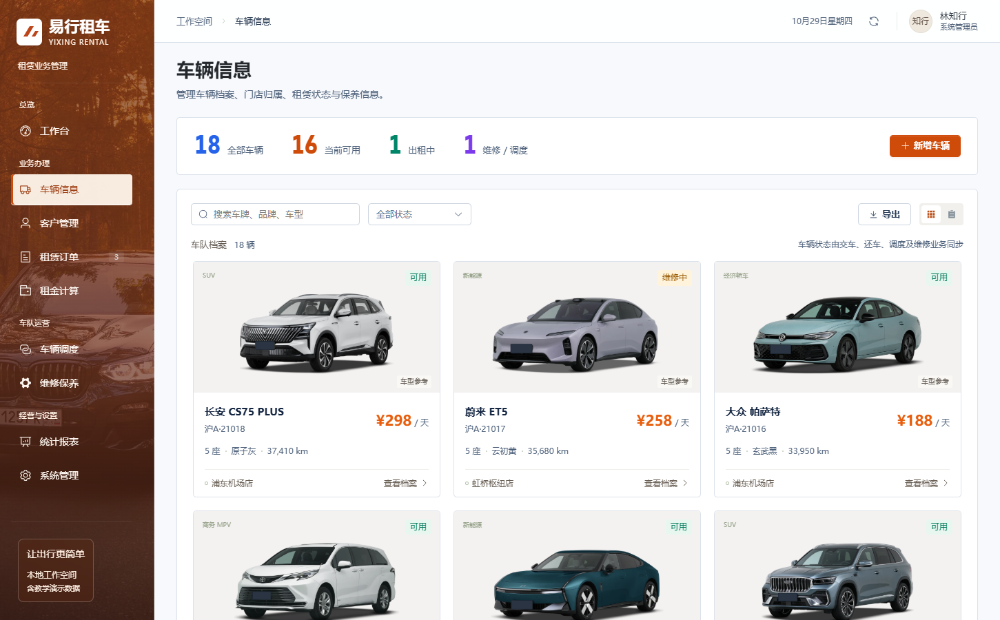

## 7. 客户管理

证件与联系方式按现有规则脱敏展示。

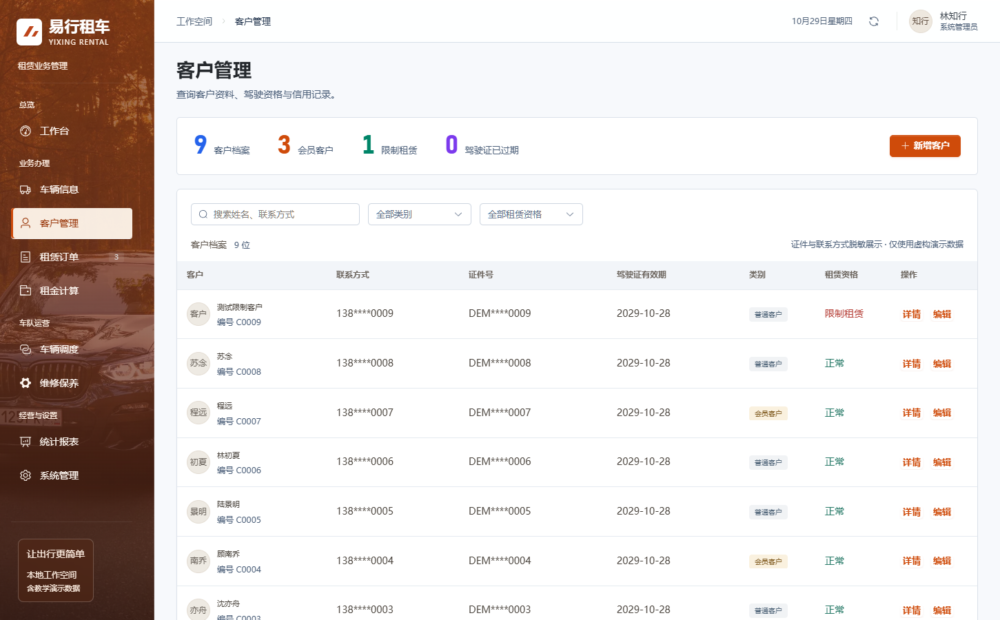

## 8. 租赁订单

订单列表、车辆缩略图与分色运营数字。

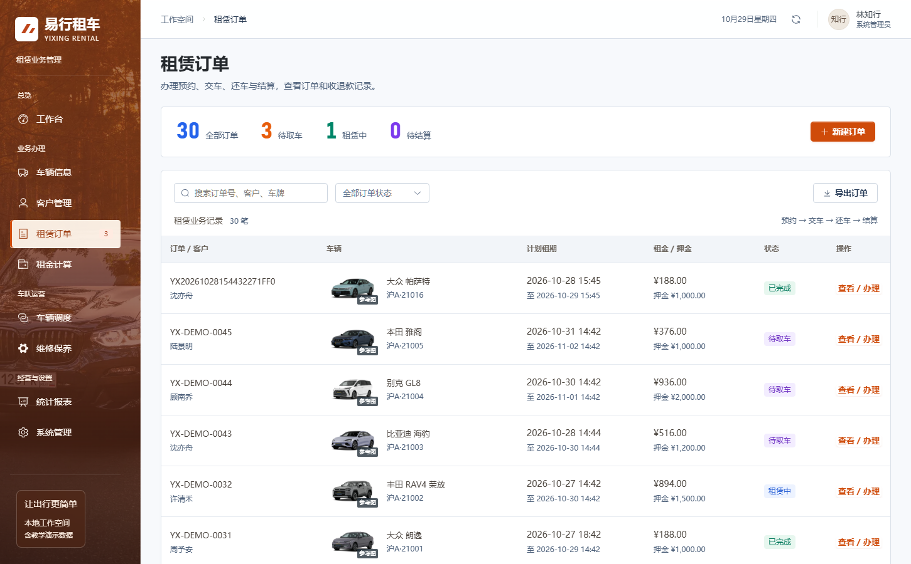

## 9. 订单详情

只打开详情抽屉，不执行收款、交还车或结算。

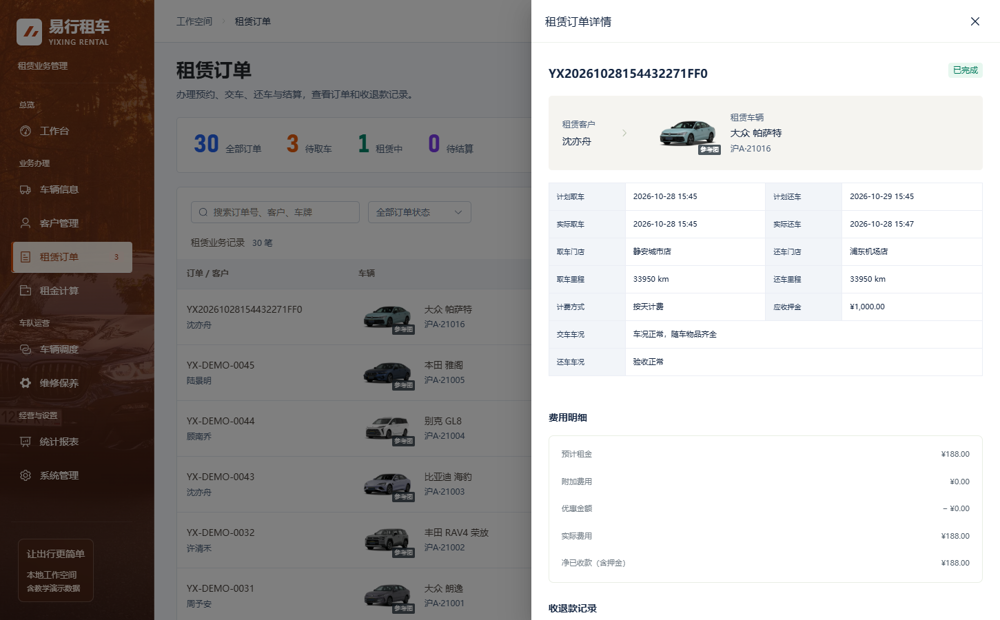

## 10. 租金试算

按天计费输入与车辆报价。

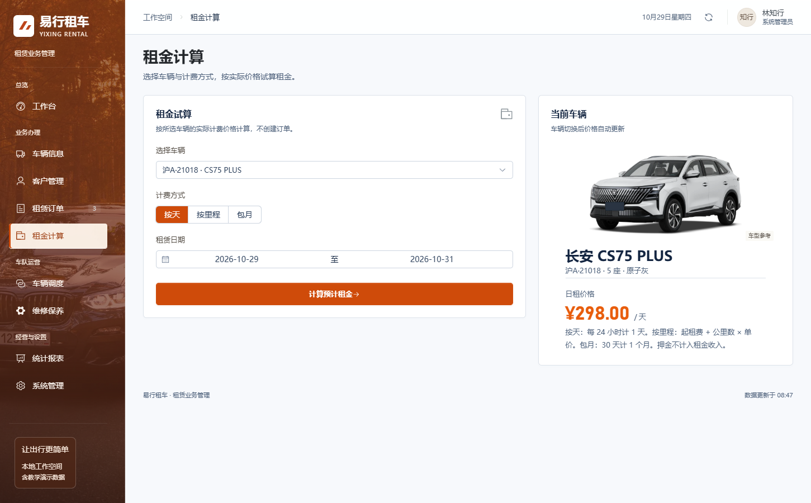

## 11. 包月计费

选择本年度起租月份，保留既有计费口径。

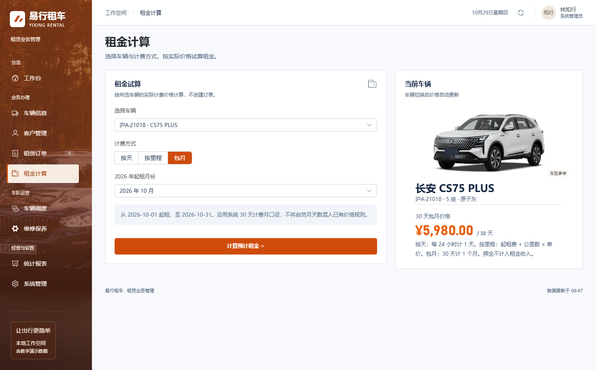

## 12. 车辆调度

门店运力与车辆调度任务。

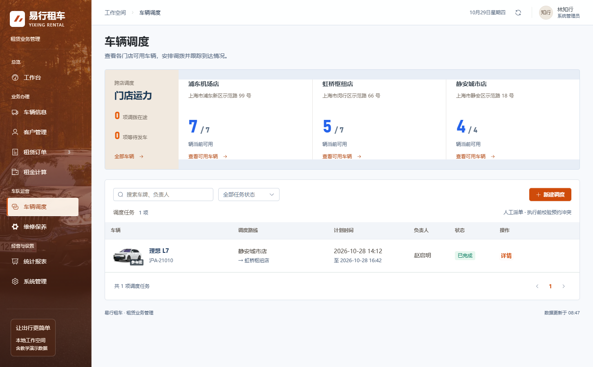

## 13. 维修保养

当前保养提醒、车辆图片和工单列表。

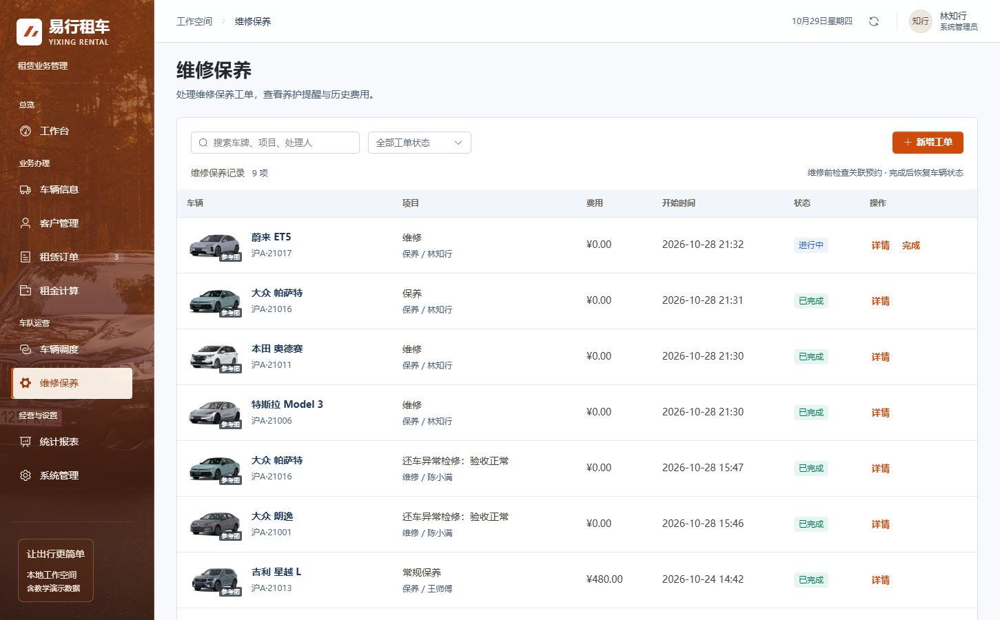

## 14. 经营趋势

真实已结算租金与订单趋势。

## 15. 车辆使用排行

同一排行可切换出租时长、次数与租金收入。

## 16. 账号与权限

管理员、业务人员与客户账户的权限说明。

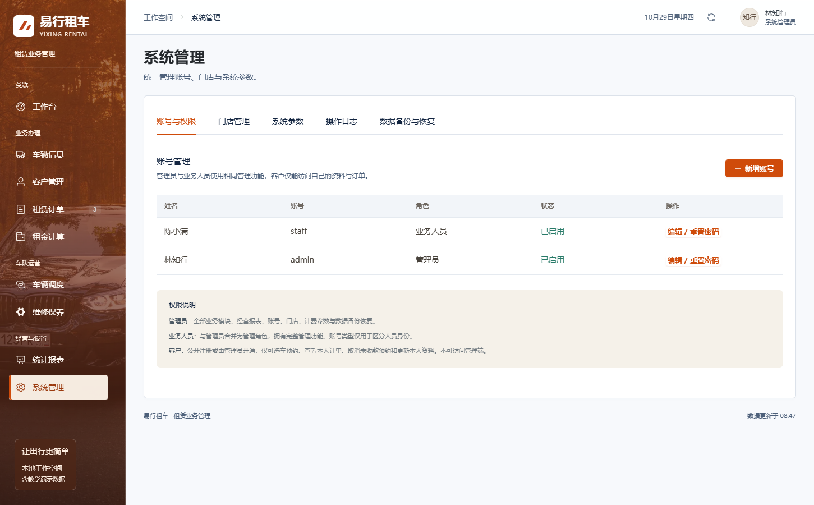

## 17. 系统参数

保留提醒等参数，不包含公司名称编辑。

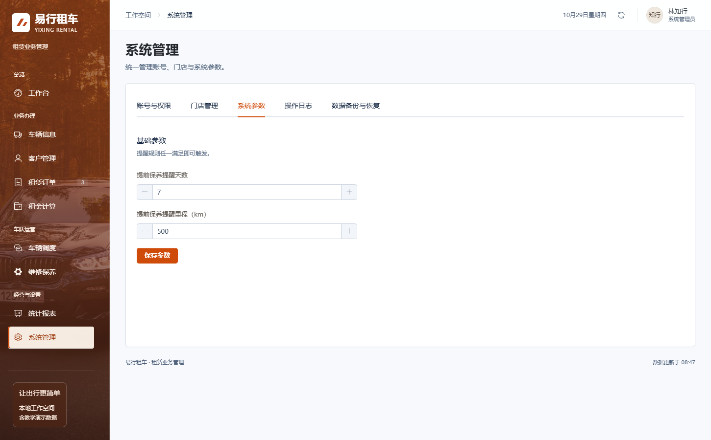

## 18. 窄屏工作台

390px 宽度实测，无整页横向溢出。

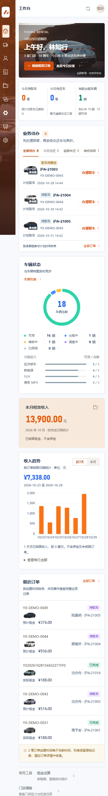

## 19. 窄屏车辆信息

车辆图文与操作保持可读。

## 20. 窄屏订单

窄屏订单卡片展示。

## 21. 快速启动程序

原生 Windows 启动器，截图为复用已有服务后的实际状态。

## 重新生成网页截图

先启动系统并安装 `tests/requirements.txt` 中的浏览器测试依赖，再运行 `python tests/refresh_screenshots.py`。此命令只浏览页面和打开只读详情，不创建客户、订单或流水。启动器截图使用 Windows 上的 `python tests/launcher_window_preview.py` 生成。

更早的 `previews/` 图片保留为历史验收证据，当前效果统一以本文及 `previews/current/` 为准。
